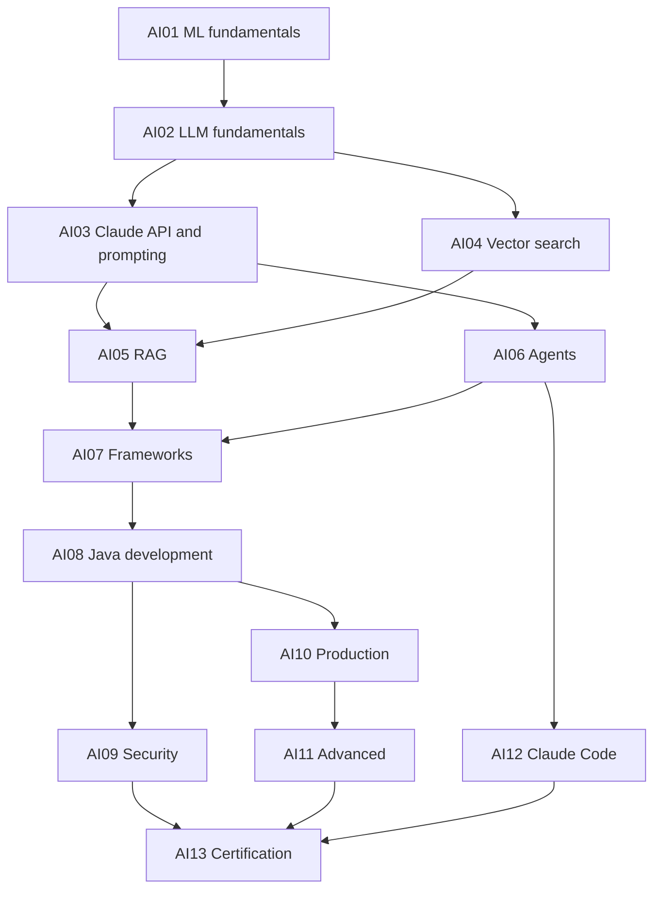

# AI Engineering and Claude Architect Course: Roadmap

*Generated by `scripts/gen_roadmap.py`. Edit the script and `ROADMAP_INTRO.md`, not this file.*

**Reader:** about 4.5 years' experience in Java, Spring Boot, microservices, Kafka, Redis, SQL and AWS.

**Goal:** design, build, secure and run production Claude systems, then pass CCAR-F. Exam material comes last and gets the heaviest treatment, as requested.

**Format:** the same notebook-style A4 PDFs as `../system-design-course` and `../lld-course`. Markdown and diagram sources are the truth, and PDFs are generated.

## Shape of the course

| Part | Module | Title | Lessons | Design problems | Pages | Exam value |
| --- | --- | --- | ---: | ---: | ---: | --- |
| I Foundations | **AI01** | AI and Machine Learning Fundamentals | 4 | 0 | 100 | Support |
| I Foundations | **AI02** | Generative AI and LLM Fundamentals | 7 | 0 | 180 | Support |
| I Foundations | **AI03** | Working With Claude: API, Prompting and Context | 6 | 0 | 156 | Core |
| II Retrieval | **AI04** | Vector Databases and Search | 5 | 1 | 136 | Support |
| II Retrieval | **AI05** | RAG | 7 | 1 | 186 | Support |
| III Agents and Frameworks | **AI06** | AI Agents and Agentic AI | 10 | 2 | 304 | Core |
| III Agents and Frameworks | **AI07** | AI Frameworks | 4 | 0 | 98 | Low |
| IV Building for Production | **AI08** | AI Application Development in Java | 8 | 1 | 228 | Low |
| IV Building for Production | **AI09** | AI Security | 5 | 0 | 132 | Indirect |
| IV Building for Production | **AI10** | AI Production Engineering | 7 | 1 | 194 | Partial |
| IV Building for Production | **AI11** | Advanced AI Topics | 5 | 0 | 122 | Low |
| V Certification | **AI12** | Claude Code | 5 | 0 | 122 | Core |
| V Certification | **AI13** | Certification Preparation | 12 | 0 | 474 | Exam |
| | | **Total** | **85** | **6** | **2432** | |

**Size:** 85 lessons, 6 design problems, about 2,432 pages and 522,880 words, at the ~215 words per page measured across the HLD and LLD courses. Page budgets are planning estimates. Size each lesson to its budget, and split it if it needs more.

**Exam-critical subset:** AI03, AI06, AI12 and AI13 total about 1056 pages. If an exam date becomes urgent, these can be written first, because each is usable with cross-references to material written later.

## Your topic list and where each topic lives

| You asked for | Module | Change from your order |
| --- | --- | --- |
| AI and machine learning fundamentals | AI01 | — |
| Generative AI and LLM fundamentals | AI02 | — |
| RAG | AI05 | Comes after vector databases |
| AI agents and agentic AI | AI06 | — |
| AI frameworks | AI07 | — |
| Vector DBs and search | AI04 | **Moved before RAG**, since RAG depends on it |
| AI application development (Java backend) | AI08 | — |
| AI security and production engineering | AI09, AI10 | Split, because each is large |
| Advanced AI topics | AI11 | — |
| Certification and question types, at the end | AI12, AI13 | — |

**Two modules were added:**

- **AI03** teaches the API, prompting and context engineering. Your list doesn't name them, but RAG, agents and 35% of the exam (Domains 4 and 5) depend on them.
- **AI12** teaches Claude Code. Domain 3 is 20% of the exam, and a revision module can't review something never taught.

## Dependencies

## Delivery

One module at a time, in order. A module counts as complete only when it passes the gates in `CLAUDE.md`. Each module works as a stopping point, so you can review it and redirect before more is written.

**Estimated effort for you:** about 1.5 minutes per page, measured from the pilot's reading-time estimate rather than from readers, so treat it as rough.

# Lesson-by-lesson plan

## AI01: AI and Machine Learning Fundamentals (4 lessons, ~100 pages)

Your first topic. Builds the vocabulary everything else uses.

| # | Lesson | Pages | Type |
| ---: | --- | ---: | --- |
| 1 | What Learning From Data Means | 22 | Lesson |
| 2 | Classical ML and How to Measure It | 28 | Lesson |
| 3 | Neural Networks and How They Train | 28 | Lesson |
| 4 | From Word Counts to Word Vectors | 22 | Lesson |

## AI02: Generative AI and LLM Fundamentals (7 lessons, ~180 pages)

Your second topic. Why LLMs behave as they do, and how Anthropic approaches training.

| # | Lesson | Pages | Type |
| ---: | --- | ---: | --- |
| 1 | Tokens and Tokenization | 20 | Lesson |
| 2 | Attention From First Principles | 28 | Lesson |
| 3 | The Transformer End to End | 28 | Lesson |
| 4 | How an LLM Is Trained: RLHF and Constitutional AI | 28 | Lesson |
| 5 | Inference and Model Serving Internals | 30 | Lesson |
| 6 | Why LLMs Fail: Hallucination, Position and Interpretability | 26 | Lesson |
| 7 | Generative AI Beyond Text and Choosing a Model | 20 | Lesson |

## AI03: Working With Claude: API, Prompting and Context (6 lessons, ~156 pages)

Added: not in your list, but RAG, agents and the exam all depend on it.

| # | Lesson | Pages | Type |
| ---: | --- | ---: | --- |
| 1 | The Messages API: Stateless by Design | 24 | Lesson |
| 2 | Prompt Engineering That Survives Production | 30 | Lesson |
| 3 | Structured Output and Validation Loops | 28 | Lesson |
| 4 | Thinking, Effort and Model Selection | 20 | Lesson |
| 5 | Prompt Caching and Batches: The Economics | 26 | Lesson |
| 6 | Context Engineering | 28 | Lesson |

## AI04: Vector Databases and Search (5 lessons, ~136 pages)

Moved before RAG, because RAG is built on it. Deepens HLD M21A rather than repeating it.

| # | Lesson | Pages | Type |
| ---: | --- | ---: | --- |
| 1 | Choosing and Operating Embedding Models | 22 | Lesson |
| 2 | ANN Indexes in Production: Filtering and Quantization | 28 | Lesson |
| 3 | Hybrid Search and Reranking | 24 | Lesson |
| 4 | Choosing a Vector Store: pgvector to Dedicated Engines | 22 | Lesson |
| 5 | Design a Multi-Tenant Vector Search Platform | 40 | Design problem (10 parts, 6 diagrams) |

## AI05: RAG (7 lessons, ~186 pages)

Your third topic. Provenance (TS 5.6) is the part the exam tests.

| # | Lesson | Pages | Type |
| ---: | --- | ---: | --- |
| 1 | Why RAG Exists and When Not to Use It | 22 | Lesson |
| 2 | Ingestion and Chunking | 28 | Lesson |
| 3 | Contextual Retrieval | 20 | Drafted as pilot |
| 4 | Query Understanding, Context Assembly and Citations | 24 | Lesson |
| 5 | The RAG Family: Graph, SQL, Agentic, Multimodal, Self-RAG | 26 | Lesson |
| 6 | Evaluating RAG | 24 | Lesson |
| 7 | Design an Enterprise Knowledge Assistant | 42 | Design problem (10 parts, 6 diagrams) |

## AI06: AI Agents and Agentic AI (10 lessons, ~304 pages)

Your fourth topic. The exam's largest area: Domains 1, 2 and part of 5.

| # | Lesson | Pages | Type |
| ---: | --- | ---: | --- |
| 1 | Workflows or Agents: Building Effective Agents | 26 | Lesson |
| 2 | The Agentic Loop | 26 | Lesson |
| 3 | Designing Tools an Agent Can Use | 28 | Lesson |
| 4 | MCP: Architecture and Primitives | 30 | Lesson |
| 5 | MCP: Integration, Servers and Errors | 24 | Lesson |
| 6 | Multi-Agent Orchestration: Anthropic's Research System | 32 | Lesson |
| 7 | Sessions, Memory and Long-Running Harnesses | 28 | Lesson |
| 8 | Hooks, Enforcement, Escalation and Humans in the Loop | 26 | Lesson |
| 9 | Design a Customer Support Resolution Agent | 42 | Design problem (10 parts, 6 diagrams) |
| 10 | Design a Multi-Agent Research System | 42 | Design problem (10 parts, 6 diagrams) |

## AI07: AI Frameworks (4 lessons, ~98 pages)

Your fifth topic. When a framework helps, and when the SDK is better.

| # | Lesson | Pages | Type |
| ---: | --- | ---: | --- |
| 1 | Do You Need a Framework? SDK to Managed Agents | 24 | Lesson |
| 2 | LangChain and LangGraph | 26 | Lesson |
| 3 | LlamaIndex and Other Frameworks | 20 | Lesson |
| 4 | Spring AI and LangChain4j | 28 | Lesson |

## AI08: AI Application Development in Java (8 lessons, ~228 pages)

Your seventh topic. Compiled Java throughout, with the Banking Assistant as the capstone.

| # | Lesson | Pages | Type |
| ---: | --- | ---: | --- |
| 1 | Claude in Spring Boot: Client, Config, Errors | 28 | Lesson |
| 2 | Streaming to Users: SSE and Virtual Threads | 24 | Lesson |
| 3 | A Production Agent Loop and Tools in Java | 30 | Lesson |
| 4 | Building an MCP Server in Java | 26 | Lesson |
| 5 | A RAG Service With pgvector | 30 | Lesson |
| 6 | Async AI: Kafka, Batches and Workflows | 26 | Lesson |
| 7 | Testing AI Code | 24 | Lesson |
| 8 | Design a Banking Transaction Analysis Assistant | 40 | Design problem (10 parts, 6 diagrams) |

## AI09: AI Security (5 lessons, ~132 pages)

First half of your eighth topic. Exam tests least privilege and hooks, not a security domain.

| # | Lesson | Pages | Type |
| ---: | --- | ---: | --- |
| 1 | Threat Modelling an AI System | 24 | Lesson |
| 2 | Prompt Injection: The Problem That Has No Patch | 30 | Lesson |
| 3 | Securing Tools, MCP and Sandboxes | 26 | Lesson |
| 4 | PII, Tenancy, RBAC, Secrets and Audit | 26 | Lesson |
| 5 | Jailbreaks, Guardrails and Responsible AI | 26 | Lesson |

## AI10: AI Production Engineering (7 lessons, ~194 pages)

Second half of your eighth topic. Real production architectures live here.

| # | Lesson | Pages | Type |
| ---: | --- | ---: | --- |
| 1 | Reliability: Retries, Rate Limits and Fallbacks | 26 | Lesson |
| 2 | AI Gateways and Model Routing | 24 | Lesson |
| 3 | Evals: Datasets, Hallucination and CI Gates | 30 | Lesson |
| 4 | Observability: Traces, Tokens and Cost | 24 | Lesson |
| 5 | Cost Engineering and Semantic Caching | 24 | Lesson |
| 6 | Deployment, Multi-Tenancy and Disaster Recovery | 24 | Lesson |
| 7 | Design an LLM Gateway | 42 | Design problem (10 parts, 6 diagrams) |

## AI11: Advanced AI Topics (5 lessons, ~122 pages)

Your ninth topic. Beyond the exam, for senior interviews and judgment.

| # | Lesson | Pages | Type |
| ---: | --- | ---: | --- |
| 1 | Fine-Tuning, LoRA and When Not to Bother | 24 | Lesson |
| 2 | Self-Hosting Open Models and Quantization | 24 | Lesson |
| 3 | Interpretability and Alignment Research | 24 | Lesson |
| 4 | Autonomy: Code Execution and Computer Use | 24 | Lesson |
| 5 | Event-Driven AI, Workflow Engines and Sagas | 26 | Lesson |

## AI12: Claude Code (5 lessons, ~122 pages)

Added: Domain 3 is 20% of the exam and needs a teaching home before revision.

| # | Lesson | Pages | Type |
| ---: | --- | ---: | --- |
| 1 | How Claude Code Works and Its Built-In Tools | 24 | Lesson |
| 2 | CLAUDE.md, Rules and Memory | 24 | Lesson |
| 3 | Commands, Skills, Subagents and Hooks | 28 | Lesson |
| 4 | Plan Mode and Iterative Refinement | 22 | Lesson |
| 5 | Claude Code in CI/CD | 24 | Lesson |

## AI13: Certification Preparation (12 lessons, ~474 pages)

The heaviest focus, as you asked. Reviews and tests; it doesn't reteach.

| # | Lesson | Pages | Type |
| ---: | --- | ---: | --- |
| 1 | The Exam Decoded: How Scenario Questions Are Built | 24 | Certification |
| 2 | Domain 1 Review and Question Bank | 58 | Certification |
| 3 | Domain 2 Review and Question Bank | 42 | Certification |
| 4 | Domain 3 Review and Question Bank | 46 | Certification |
| 5 | Domain 4 Review and Question Bank | 46 | Certification |
| 6 | Domain 5 Review and Question Bank | 36 | Certification |
| 7 | The Six Scenarios Walked Through | 36 | Certification |
| 8 | Question Types Lab: All 18 Formats | 36 | Certification |
| 9 | Mock Exam 1 | 42 | Certification |
| 10 | Mock Exam 2 | 42 | Certification |
| 11 | Mock Exam 3 | 42 | Certification |
| 12 | Final Revision Handbook and Readiness Check | 24 | Certification |
