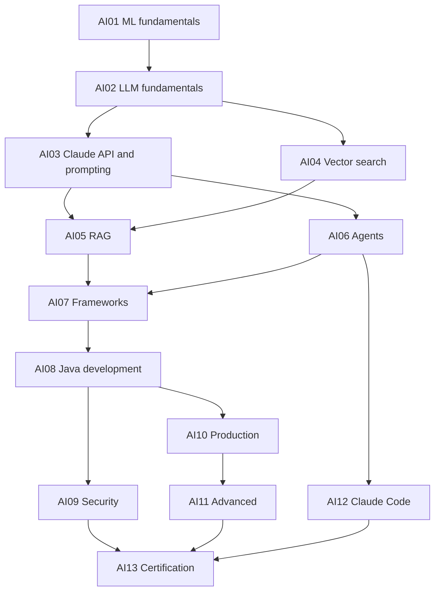

# AI Engineering and Claude Architect Course: Roadmap

*Generated by `scripts/gen_roadmap.py`. Edit the script and `ROADMAP_INTRO.md`, not this file.*

**Reader:** about 4.5 years' experience in Java, Spring Boot, microservices, Kafka, Redis, SQL and AWS.

**Goal:** design, build, secure and run production Claude systems, then pass CCAR-F. Exam material comes last and gets the heaviest treatment, as requested.

**Format:** the same notebook-style A4 PDFs as `../system-design-course` and `../lld-course`. Markdown and diagram sources are the truth, and PDFs are generated.

## Shape of the course

{{SUMMARY}}

**Size:** {{LESSONS}} lessons, {{DPS}} design problems, about {{PAGES}} pages and {{WORDS}} words, at the ~215 words per page measured across the HLD and LLD courses. Page budgets are planning estimates. Size each lesson to its budget, and split it if it needs more.

**Exam-critical subset:** AI03, AI06, AI12 and AI13 total about {{CORE}} pages. If an exam date becomes urgent, these can be written first, because each is usable with cross-references to material written later.

## Your topic list and where each topic lives

| You asked for | Module | Change from your order |
| --- | --- | --- |
| AI and machine learning fundamentals | AI01 | — |
| Generative AI and LLM fundamentals | AI02 | — |
| RAG | AI05 | Comes after vector databases |
| AI agents and agentic AI | AI06 | — |
| AI frameworks | AI07 | — |
| Vector DBs and search | AI04 | **Moved before RAG**, since RAG depends on it |
| AI application development (Java backend) | AI08 | — |
| AI security and production engineering | AI09, AI10 | Split, because each is large |
| Advanced AI topics | AI11 | — |
| Certification and question types, at the end | AI12, AI13 | — |

**Two modules were added:**

- **AI03** teaches the API, prompting and context engineering. Your list doesn't name them, but RAG, agents and 35% of the exam (Domains 4 and 5) depend on them.
- **AI12** teaches Claude Code. Domain 3 is 20% of the exam, and a revision module can't review something never taught.

## Dependencies

## Delivery

One module at a time, in order. A module counts as complete only when it passes the gates in `CLAUDE.md`. Each module works as a stopping point, so you can review it and redirect before more is written.

**Estimated effort for you:** about 1.5 minutes per page, measured from the pilot's reading-time estimate rather than from readers, so treat it as rough.

